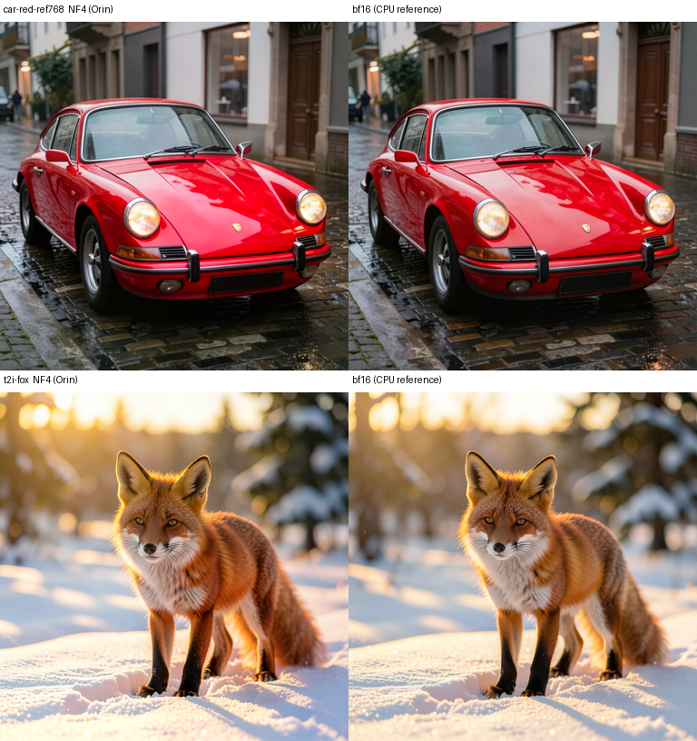
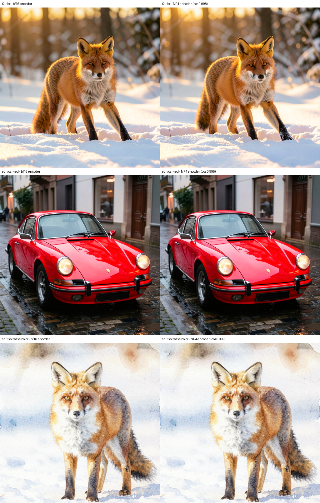
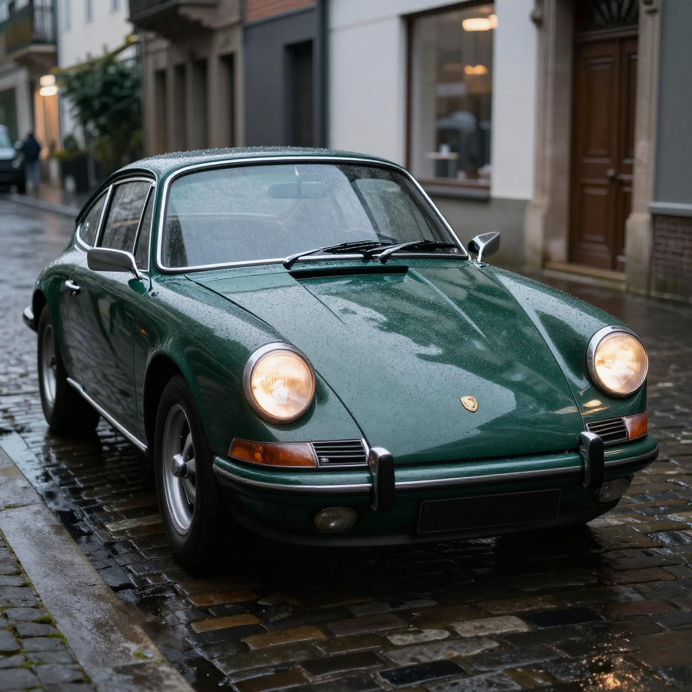
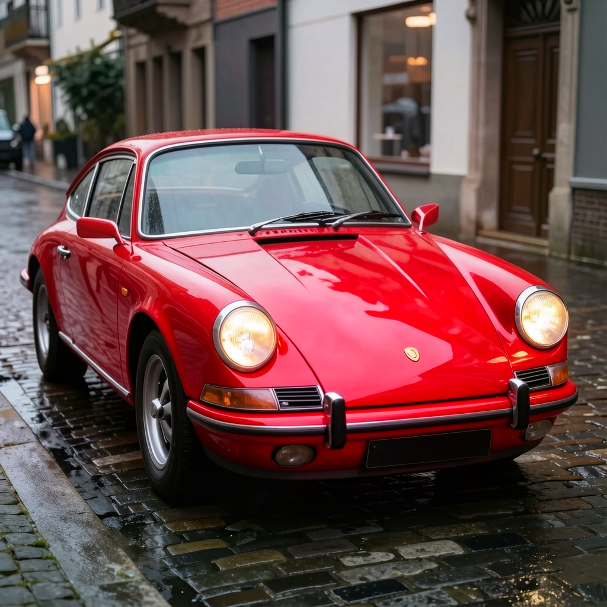
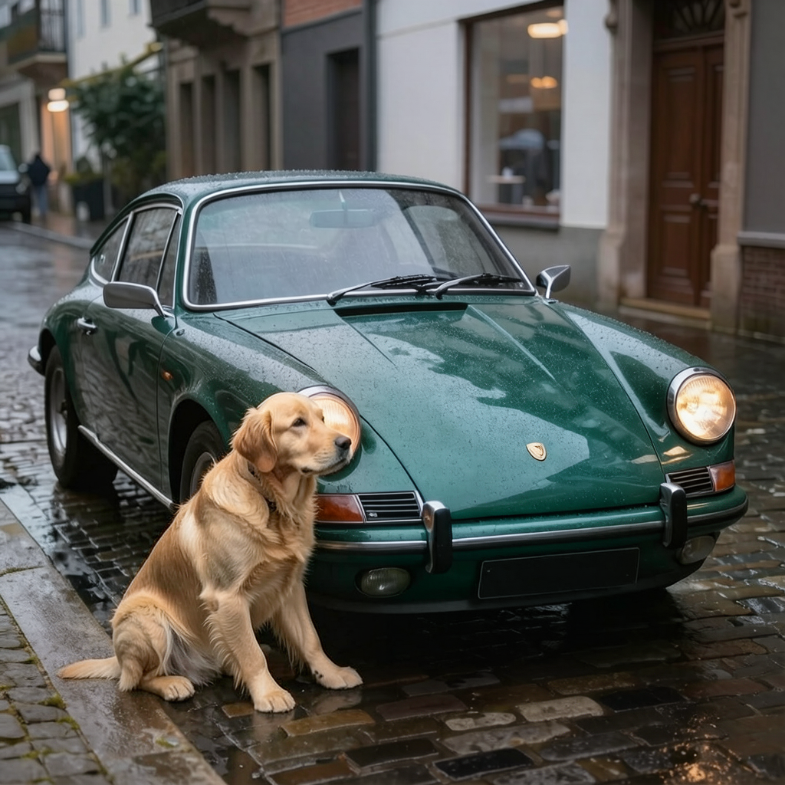
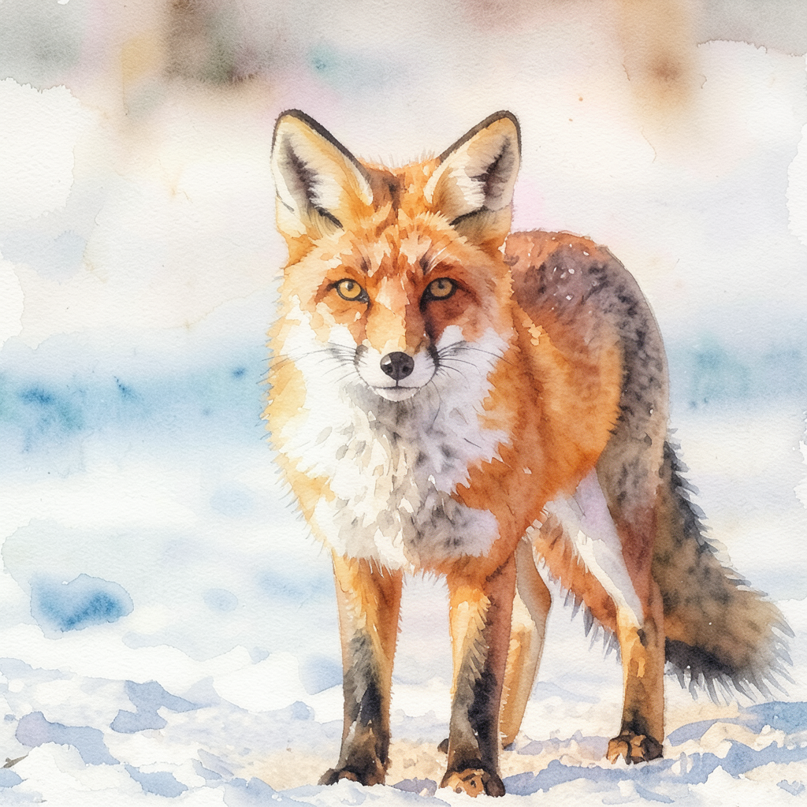

# FLUX.2-klein-4B NF4

[FLUX.2-klein-4B](https://huggingface.co/black-forest-labs/FLUX.2-klein-4B) (commit
`e7b7dc27f91d`) with the transformer and the Qwen3-4B text encoder quantized to bitsandbytes
NF4. Full pipeline, loads with `Flux2KleinPipeline.from_pretrained`. Image editing with 1-3
reference images, and text-to-image.

Built to pair with [qwen3-4b-remote-text-encoder](https://github.com/Cukrus-directive/qwen3-4b-remote-text-encoder):
run the text encoder on a separate machine and keep only the transformer and VAE on the GPU
(~2.5 GB). Works on 8 GB devices like the Jetson Orin Nano.

| | bf16 | NF4 |
|---|---|---|
| transformer | 7.75 GB | 2.29 GB |
| text encoder (Qwen3-4B) | 8.05 GB | 2.65 GB |
| VAE | 168 MB | 168 MB (unchanged) |
| total | ~16 GB | ~5.1 GB |



## Quantization

- NF4, double quant, bf16 compute
- kept in bf16 (~0.37 GB): `x_embedder`, `context_embedder`, `time_guidance_embed`,
  `double_stream_modulation_img`, `double_stream_modulation_txt`, `single_stream_modulation`,
  `norm_out`, `proj_out`
- text encoder: all 252 attention/MLP Linears in NF4 (double quant, bf16 compute),
  embeddings and tied `lm_head` in bf16
- VAE and scheduler unchanged

`klein-quantize.py` (transformer) and `klein-te-quantize.py` (text encoder) re-shard the
source into 1 GB shards before quantizing, so peak memory stays around 2.2-2.5 GB. Both run
on an 8 GB Jetson.

## Sanity check vs bf16

Transformer: rendered with the same seed, initial noise and prompt embeddings in NF4 and bf16.

| | PSNR | mean abs diff |
|---|---|---|
| edit, car to red | 24.5 dB | 9.2 / 255 |
| text-to-image, fox | 21.0 dB | 15.3 / 255 |

Text encoder: prompt embeddings from the NF4 encoder vs bf16, same NF4 transformer and seed.

| | cosine | rel. L2 |
|---|---|---|
| text-to-image, fox | 0.998 | 0.091 |
| edit, car to red | 0.995 | 0.121 |
| edit, watercolor | 0.999 | 0.085 |



## Examples

4 steps, generated on a Jetson Orin Nano 8GB.

| source | "change the car's paint to glossy bright red, keep everything else the same" | "add a golden retriever sitting on the sidewalk next to the car" |
|---|---|---|
|  |  |  |

| source | "turn this photo into a loose watercolor painting" | text-to-image: "a red fox standing in fresh snow, golden hour, photorealistic" |
|---|---|---|
|  |  |  |

## Usage

Requires diffusers 0.37+ and bitsandbytes with kernels for your GPU (on Jetson, build it from
source with `-DCOMPUTE_CAPABILITY=87`).

```python
import torch
from diffusers import Flux2KleinPipeline
from diffusers.utils import load_image

pipe = Flux2KleinPipeline.from_pretrained("cukrus/FLUX.2-klein-4B-bnb-nf4",
                                          torch_dtype=torch.bfloat16).to("cuda")
pipe.vae.enable_tiling()
pipe.vae.tile_sample_min_size = 512   # default 1024 doesn't tile a 1024px image
pipe.vae.tile_latent_min_size = 64

out = pipe(prompt="change the car's paint to glossy bright red, keep everything else the same",
           image=load_image("car.png"),  # or a list of up to 3
           num_inference_steps=4, guidance_scale=1.0,
           generator=torch.Generator("cuda").manual_seed(4200)).images[0]
out.save("edit.png")
```

Use `num_inference_steps=4, guidance_scale=1.0`. The pipeline defaults (50 / 4.0) are for the
base model.

Full pipeline, 1024px text-to-image: 5.42 GB GPU peak.

bf16 text encoder instead: pass `text_encoder=Qwen3ForCausalLM.from_pretrained("black-forest-labs/FLUX.2-klein-4B", subfolder="text_encoder", torch_dtype=torch.bfloat16)`.

### Without the text encoder

Load with `text_encoder=None, tokenizer=None` and pass `prompt_embeds` of shape (1, 512, 7680): Qwen3-4B hidden states 9, 18, 27 stacked,
thinking off, right-padded to 512. Keep the pad positions, there is no text mask.
Remote encoder service:
[qwen3-4b-remote-text-encoder](https://github.com/Cukrus-directive/qwen3-4b-remote-text-encoder).

## Jetson Orin Nano 8GB

JetPack 7.2, CUDA 13.2, torch 2.12.1+cu132, diffusers 0.39. 1024x1024, 4 steps, VAE tiled at
512px, text encoder on a separate machine (bf16).

| | reference | denoise | total | torch peak | system RAM free (min) |
|---|---|---|---|---|---|
| text-to-image | - | 24.9 s | 37.2 s | 2.95 GB | 2.54 GB |
| edit | 512px | 31.1 s | 43.5 s | 3.09 GB | 2.37 GB |
| edit | 768px | 39.6 s | 44-52 s | 3.25 GB | 1.83-2.26 GB |
| edit | 1024px | 52.2 s | 57.9 s | 3.46 GB | 1.85 GB |

Total includes ~8 s encoding for a new prompt. Each reference adds as many tokens as the
output (1024px = 4096). References below 1 MP are faster but the framing drifts slightly.

Full pipeline on the board (NF4 encoder resident): 1024px text-to-image in 31.1 s, system RAM
free drops to 0.08 GB. Works, but too tight to serve that way on 8 GB unified memory.

## License

Apache-2.0, same as [FLUX.2-klein-4B](https://huggingface.co/black-forest-labs/FLUX.2-klein-4B)
by Black Forest Labs.
